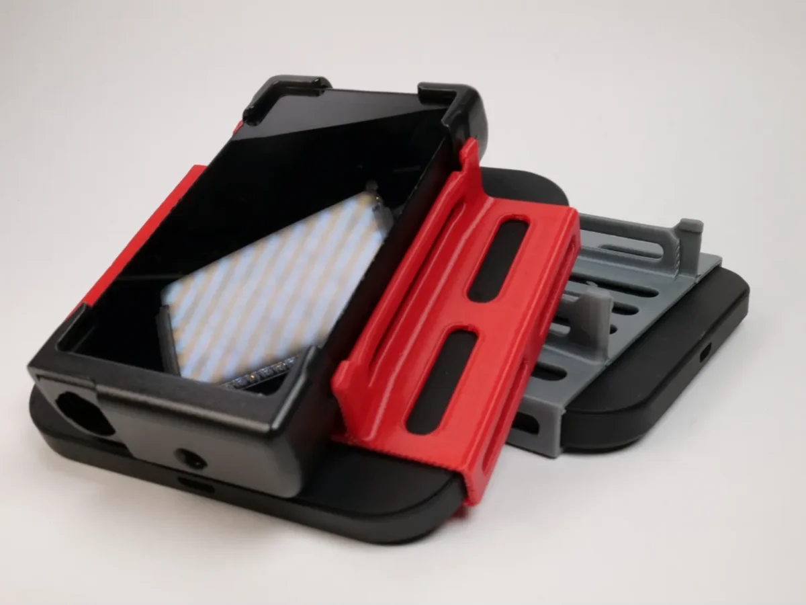
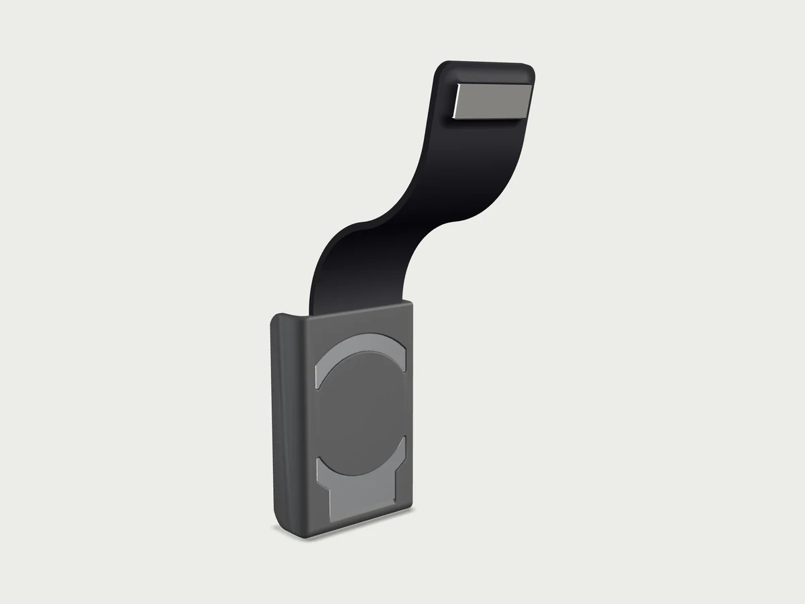

The iLet charges on a flat pad, and it's up to you to set it down in the right spot.

For a long time, our fix was a rubber band. It held the pump to a MagSafe battery pack, and the battery did the rest. It worked. It wasn't a product.

## Two ideas, one shelf

That rubber band turned into two ideas.

The first was an adapter plate: something that clipped onto the iLet's own case, with a MagSafe ring built in, so any MagSafe charger would do. It turned out to be a much bigger design problem than we were ready for. It went on the shelf.

The second came at it from the other side. Leave the pump alone and fix the charger. That became the iLet Charger Adapter, our first product. It holds the iLet in the same spot on its charging pad, every time.

It solved charging with the case and charger the iLet comes with. We wanted more than that: more chargers, more mounts and one less thing to line up.

## The case we didn't make (yet)

The plan was a slim, modular case: a thin inner shell, with accessories that clip on and off depending on the day. It's still a good idea, and we may come back to it. For where our design skills were, it was too big a hill.

## One piece

So we made it one piece. A single PETG shell, with steel plates built into the back. The plates hold to MagSafe-compatible chargers and mounts, and to the case's own strap, which closes with one magnet.

One piece meant fewer joints to get right. It didn't mean fewer prints.

## What didn't work, and what did

To see where the glue was actually going, we printed a shell in clear PETG and bonded it with JB Weld ClearWeld. Every joint, visible.

The plates are 430 stainless with a #4 finish, laser cut by OSHCut. Stainless so they hold up, 430 because it's magnetic. They're bonded in with a toughened epoxy.

The first strap magnets went in with E6000. It's fine on most things. On foamed TPU, it peeled right off. The magnet is now bonded with an MS polymer adhesive, which holds.

The strap itself is Siraya Tech TPU Air: foamed, matte and light, so it doesn't feel like plastic against you all day.

## Where it is now

Hundreds of iterations and more than six months of testing later, on the bench and on a belt, the case is nearly done. It soft-launches January 4, 2027.
